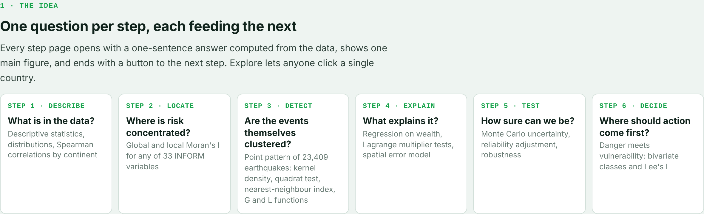
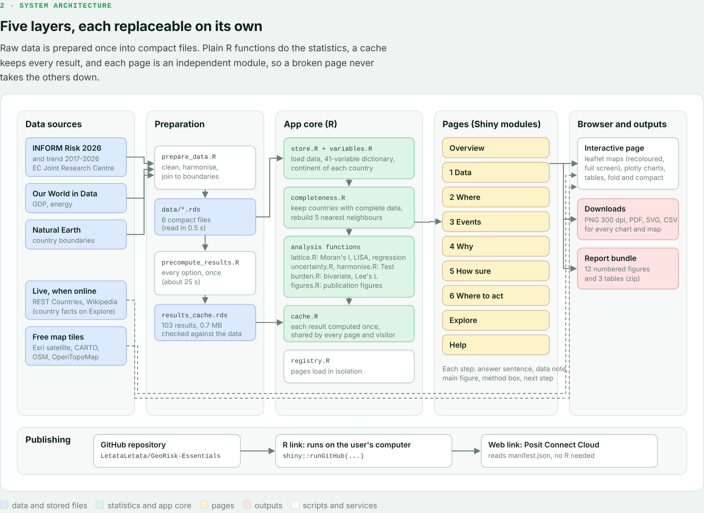
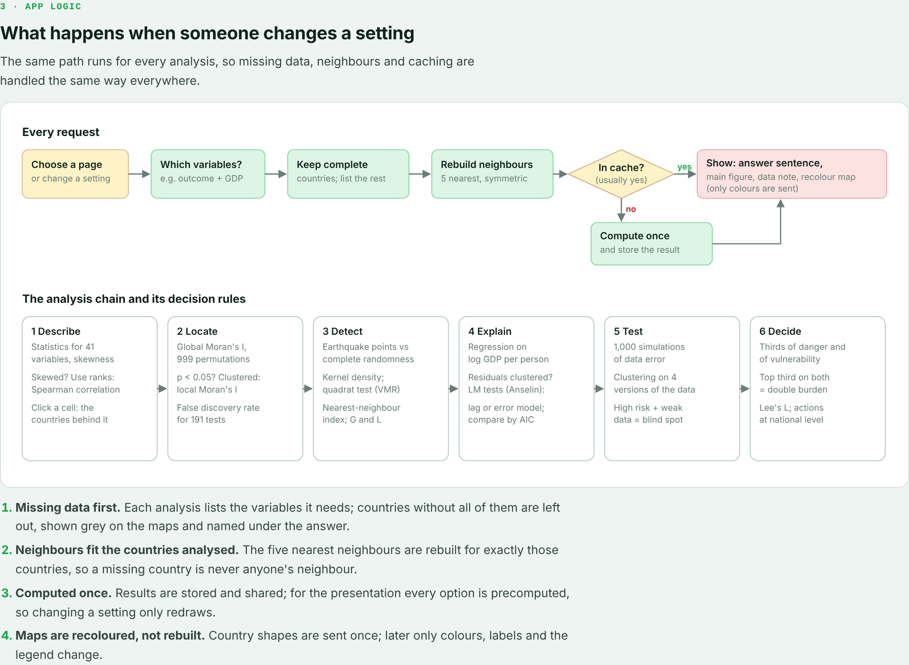
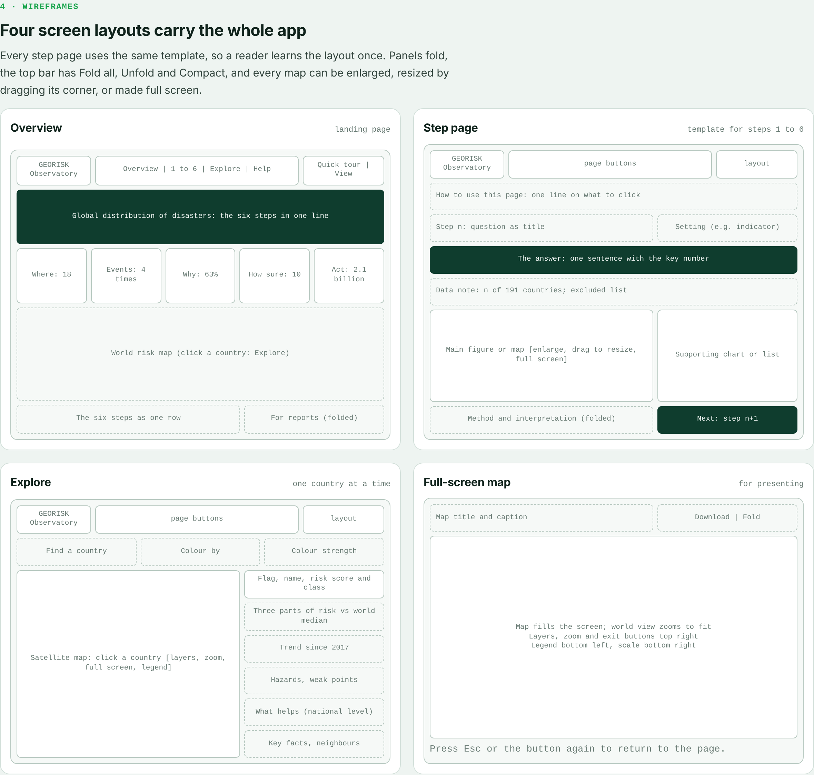

# GEORISK Observatory: how the app is built

These diagrams explain the idea, the system architecture, the app logic and the screen layouts. They are also in one page, `architecture.html` (open it in a browser), and the images below can go straight into slides.

## 1. The idea: six steps, one question each

## 2. System architecture

Raw data is prepared once into compact files. Plain R functions do the statistics, a cache keeps every result (all options are precomputed in `data/results_cache.rds`), and each page is an independent Shiny module, so a broken page never takes the others down.

## 3. App logic

Every request follows the same path: find the variables the analysis needs, keep the countries with complete data, rebuild the 5 nearest neighbours for exactly those countries, look the result up in the cache (compute it once if missing), then show the answer, the figure and the data note. Maps are recoloured rather than rebuilt.

## 4. Wireframes

